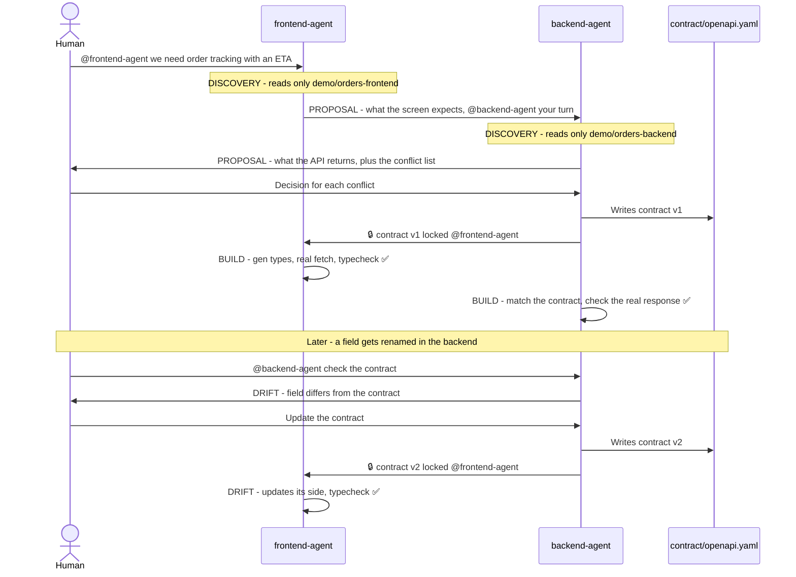

# Handshake 🤝

[](https://docs.switchagents.ai)
[](https://claude.com/claude-code)
[](#3-connect-discord)
[](contract/)
[](demo/orders-backend/)
[](demo/orders-frontend/)
[](demo/orders-frontend/)
[](demo/orders-backend/)

> **Frontend and backend coding agents agree on the API contract before they build it, with a human making the final call, all inside one Switch room.**
> Each side's Claude Code agent reads only its own code, proposes its half of the API, and turns every mismatch into a conflict list. A human decides, the contract is locked as `contract/openapi.yaml`, both agents build against it, and a contract check catches any later drift.

Built for the **Flip the Switch Hackathon** (WeMakeDevs × DevTools Academy × Switch AI) · **Track 01: Best Business Workflow** · Team **Larpers**

> 🎥 **Demo video:** (https://www.youtube.com/watch?v=tXQlxYle5gc)
> 🧪 **Evidence of a real run:** the [`final-run` branch (compare with main)](https://github.com/vaanyaagarwal27/handshake/compare/main...final-run) has the contract and the code both agents wrote in the run where everything worked end to end. An earlier rehearsal is on [`rehearsal-1`](https://github.com/vaanyaagarwal27/handshake/compare/main...rehearsal-1).


---

## Table of Contents

1. [The Problem](#the-problem)
2. [System Architecture](#system-architecture)
3. [Key Capabilities](#key-capabilities)
4. [The Demo Scenario](#the-demo-scenario)
5. [Why Switch Is Essential](#why-switch-is-essential)
6. [Why Not Just Write the Spec First, or Use Pact?](#why-not-just-write-the-spec-first-or-use-pact)
7. [Quickstart: Run It Yourself](#quickstart-run-it-yourself)
8. [Core Workflows](#core-workflows)
   - [Negotiate and Lock](#workflow-1-negotiate-and-lock)
   - [Build and Verify](#workflow-2-build-and-verify)
   - [Catch Drift](#workflow-3-catch-drift)
9. [Contract Checks](#contract-checks)
10. [Agent and Room Configuration](#agent-and-room-configuration)
11. [Project Directory Layout](#project-directory-layout)
12. [Running the Demo Again](#running-the-demo-again)
13. [Known Issue: ZodError on Permission Prompts](#known-issue-zoderror-on-permission-prompts)
14. [What's Next](#whats-next)
15. [Team](#team)

---

## The Problem

Frontend and backend teams lose days to one sentence: *"that's not the shape we agreed on."*
The frontend expects `minutesRemaining`, the backend sends a timestamp. The frontend sends `page` and `limit`, the backend returns everything. Nobody notices until integration, and by then both sides have built on the wrong assumption.

AI coding agents make this worse, not better: each one works fast on its own side, but neither knows what the other side actually does.

---

## System Architecture

```
        Vaanya (backend dev)                         Hamsini (frontend dev)
               |                                              |
               +---------------------+------------------------+
                                     |
                                     v
              +------------------------------------------------+
              |        Discord channel = one Switch room       |
              |  Room Instructions: switch/room-rules.md       |
              |  Phase tags · turn order · @mention handoffs   |
              |  "Only a human settles a conflict"             |
              +------------------------------------------------+
                        |                            |
                        v                            v
         +--------------------------+  +--------------------------+
         |  backend-agent           |  |  frontend-agent          |
         |  Claude Code via Switch  |  |  Claude Code via Switch  |
         |  Reads/edits only        |  |  Reads/edits only        |
         |  demo/orders-backend/    |  |  demo/orders-frontend/   |
         +--------------------------+  +--------------------------+
                        |                            |
                        | writes (after the          | reads, generates
                        | human decides)             | TypeScript types
                        v                            v
              +------------------------------------------------+
              |            contract/openapi.yaml               |
              |          the single source of truth            |
              +------------------------------------------------+
                                     |
                                     v
              +------------------------------------------------+
              |          scripts/check-contract.sh             |
              |  backend: real GET /orders vs the contract     |
              |  frontend: gen:types + typecheck               |
              |                ✅ / ❌                          |
              +------------------------------------------------+
```

### Message flow in the room



Every agent message starts with a phase tag: `[DISCOVERY]` `[PROPOSAL]` `[ARBITRATION]` `[LOCKED]` `[BUILD]` `[DRIFT]`.

---

## Key Capabilities

- **Two agents, two sides**: backend-agent speaks for the backend dev, frontend-agent for the frontend dev. Each reads only its own folder, like two real teams.
- **Conflicts surfaced, not hidden**: every mismatch (field names, formats, pagination, response shape) becomes one line in a conflict list, before any integration code is written.
- **Human in the loop by design**: agents never settle a conflict. A human decides in one message, in the same Discord thread.
- **One locked contract**: after the decision, backend-agent writes `contract/openapi.yaml` (OpenAPI 3) and announces `🔒 contract locked`. frontend-agent only reads it.
- **Automatic contract checks**: the backend's real response and the frontend's generated TypeScript types are both checked against the contract, with a ✅ / ❌ for each side.
- **Drift detection**: if a backend field is renamed later, the contract check fails and names the exact field. The agents' drift handoff (a human approves a contract update, frontend-agent fixes its side) follows the same room rules; see [Catch Drift](#workflow-3-catch-drift).

---

## The Demo Scenario

A food order tracking screen with an ETA. **This is a seeded demo:** the three mismatches are planted so the workflow is visible in 3 minutes. The two demo apps start out disagreeing:

| | Frontend (`demo/orders-frontend`) | Backend (`demo/orders-backend`) |
|---|---|---|
| **ETA** | expects `minutesRemaining` (number) | returns `eta` (ISO 8601 timestamp) |
| **Pagination** | sends `page` and `limit` | no pagination |
| **Response shape** | expects `{ orders, page, limit, total }` | returns a plain list |

The backend's ETAs are computed relative to the moment the server starts, so the screen always shows realistic "Arriving in N min" values.

<!-- SCREENSHOTS: remove this line and the closing one below once docs/images/ has the 5 PNGs
### Screenshots

| Conflict list | Locked contract | Both checks green |
|---|---|---|
|  |  |  |

| Before: mock data | After: real orders from the backend |
|---|---|
|  |  |
SCREENSHOTS end -->

---

## Why Switch Is Essential

Handshake doesn't work as a single agent. It needs:

- **Two agents, each representing a different person.** Both run on one Switch server.
- **Clear boundaries.** Each agent's instructions and the shared room rules limit it to its own demo folder. (We run with Bypass permissions on because of a Switch bug, see [Known Issue](#known-issue-zoderror-on-permission-prompts), so the boundary comes from the instructions, not from Switch.)
- **One shared room** where both agents and both humans talk, hand off with @mentions, and see the same conflict list.
- **A human in the loop.** Only a human message in the room can settle a conflict (see `switch/room-rules.md`).

Switch provides all four: agents connected to a team chat, per-agent instructions, rooms with shared instructions, and humans and agents in the same conversation. **Without Switch there's no shared room, and the negotiation can't happen.**

---

## Why Not Just Write the Spec First, or Use Pact?

Spec-first and contract-testing tools like Pact are great once a contract exists, but someone has to write it, and they write what they *think* each side does. Handshake's agents **discover** the mismatches by reading the real code on each side, so the conflict list reflects what the code actually does, not what someone remembers. A human settles the gaps in one message, and from then on the locked contract works like any contract-first setup: generated types, a check on every change, and drift caught early.

---

## Quickstart: Run It Yourself

### Prerequisites
- macOS (that's what we tested on)
- [Docker Desktop](https://www.docker.com/products/docker-desktop/)
- Node.js 18+ and Python 3.9+
- Claude Code, signed in
- A Discord account and a server you can add a bot to

Switch docs: https://docs.switchagents.ai

### 1. Clone the Repository
```bash
git clone https://github.com/vaanyaagarwal27/handshake.git
cd handshake
```

### 2. Run Switch Locally
1. Install and open **Docker Desktop**.
2. Install **Switch Console** and start a **local Switch server**, following the getting-started guide in the [Switch docs](https://docs.switchagents.ai).
3. Sign Claude Code in to your Switch server from Switch Console. Only the person who runs the local server can sign in to it, so both agents run on that machine. Other people take part through Discord.

### 3. Connect Discord
1. In the [Discord Developer Portal](https://discord.com/developers/applications), create an application and a bot.
2. Under **Bot → Privileged Gateway Intents**, turn on **Message Content Intent** and **Server Members Intent**.
3. Invite the bot to your server.
4. Connect the bot to your Switch server in Switch Console (see the Switch docs for Discord).

### 4. Create the Two Agents
In Switch Console, create both agents with **Claude Code**, using the settings in [Agent and Room Configuration](#agent-and-room-configuration).

### 5. Start Both Apps
Backend (http://localhost:8000):
```bash
cd demo/orders-backend
python3 -m venv .venv
source .venv/bin/activate
pip install -r requirements.txt
uvicorn main:app --reload
```

Frontend (http://localhost:5173), in a second terminal:
```bash
cd demo/orders-frontend
npm install
npm run dev
```

### 6. Set Up the Room
1. Create a new Discord channel (e.g. `#handshake`) and post any message in it, e.g. `hello`. This creates the Switch room.
2. Invite both agents, picking each one from Discord's autocomplete:
   ```
   !invite-agent @backend-agent
   !invite-agent @frontend-agent
   ```
3. In Switch Console → **Your Rooms** → your room → **Configuration → Instructions**, paste `switch/room-rules.md` and save.

### 7. Start the Negotiation
Post this in the channel and follow [Core Workflows](#core-workflows):
```
@frontend-agent we need order tracking with an ETA on the orders screen.
```

---

## Core Workflows

### Workflow 1: Negotiate and Lock
1. A human posts the feature request (step 7 above).
2. frontend-agent reads only `demo/orders-frontend/`, posts its `[PROPOSAL]` and starts a thread, ending with `@backend-agent your turn`.
3. backend-agent reads only `demo/orders-backend/` and replies in the thread with its `[PROPOSAL]` and the **conflict list**.
4. **A human decides each conflict, in the thread**, for example:
   ```
   ETA: keep eta as an ISO timestamp; frontend computes minutes remaining.
   Pagination: add page/limit query params.
   Response shape: wrap it as { orders, page, limit, total }.
   ```
5. backend-agent writes `contract/openapi.yaml` and posts `🔒 contract v1 locked @frontend-agent`.

### Workflow 2: Build and Verify
1. Both agents post `[BUILD]` and change only their own app to match the contract.
2. Run both checks from the repo root:
   ```bash
   ./scripts/check-contract.sh
   ```
3. Both sides show ✅, and http://localhost:5173 shows the backend's real orders with "Arriving in N min" computed from `eta`.

### Workflow 3: Catch Drift
> The contract check catching drift is tested. The agents' drift handoff follows the same rules but isn't shown in the demo video.

1. Simulate a breaking backend change:
   ```bash
   ./scripts/sabotage.sh
   ```
2. Post `@backend-agent check the contract`. It reports `[DRIFT]` ❌.
3. Post `@backend-agent update the contract`. It locks contract v2 and hands over to frontend-agent, which updates its side until the check is ✅ again.

---

## Contract Checks

`scripts/check-contract.sh` runs both checks against `contract/openapi.yaml` and prints ✅ / ❌:

| Side | What it checks | How |
|---|---|---|
| **Backend** | Every field's name and type in the real `GET /orders?page=1&limit=5` response | `scripts/check_contract.py`. Missing fields, extra fields and wrong types all fail. |
| **Frontend** | The UI only uses fields that exist in the contract | `npm run gen:types` (openapi-typescript) regenerates `src/api-types.ts`, then `npm run typecheck` |

```
── backend: GET /orders vs contract ──
   ✅ response.orders[].eta
   ...
✅ backend matches the contract

── frontend: generated types + typecheck ──
✅ frontend matches the contract

✅ backend ✅ frontend: both sides match contract/openapi.yaml
```

After `scripts/sabotage.sh` renames `eta` to `estimated_arrival`, the backend half fails with `eta: missing` and `estimated_arrival: not in contract`.

---

## Agent and Room Configuration

| Agent | Agent Directory | Instructions | Works only in |
|---|---|---|---|
| `backend-agent` | the **repo root** (e.g. `~/handshake`) | contents of `switch/backend-agent.md` | `demo/orders-backend/` (+ writes `contract/`) |
| `frontend-agent` | the **repo root** (e.g. `~/handshake`) | contents of `switch/frontend-agent.md` | `demo/orders-frontend/` (reads `contract/`) |

Both agents use the repo root so they can reach `contract/openapi.yaml`. Their instructions and the room rules limit each one to its own `demo/` folder.

| Setting (both agents) | Value | Why |
|---|---|---|
| Auto mode | On | |
| Bypass permissions | On | Workaround for the [Known Issue](#known-issue-zoderror-on-permission-prompts) |
| Who can talk to your agent | Anyone | Lets each agent answer the other agent's @mentions (fine on a private server) |
| Persistent memory | Off | Keeps every run independent |

---

## Project Directory Layout

```text
handshake/
├── README.md                     # This file
│
├── switch/                       # Everything Switch needs
│   ├── backend-agent.md          # backend-agent's instructions
│   ├── frontend-agent.md         # frontend-agent's instructions
│   └── room-rules.md             # Pasted into the room's Instructions in Switch
│
├── contract/                     # The agreed API
│   └── openapi.yaml              # Written by backend-agent at the lock (not in the repo at the start)
│
├── demo/
│   ├── orders-backend/           # backend-agent's code: Python + FastAPI (:8000)
│   │   ├── main.py               # GET /orders
│   │   ├── data.py               # 12 seeded orders, ETAs relative to server start
│   │   └── requirements.txt
│   └── orders-frontend/          # frontend-agent's code: React + Vite + TypeScript (:5173)
│       ├── package.json          # Scripts: dev, gen:types, typecheck
│       └── src/
│           ├── OrdersScreen.tsx  # Order cards, "Arriving in N min", Prev / Next
│           ├── api.ts            # fetchOrders(page, limit)
│           └── mockOrders.ts     # Mock data the screen starts with
│
├── scripts/
│   ├── check-contract.sh         # Runs both contract checks, prints ✅ / ❌
│   ├── check_contract.py         # Backend half: real response vs contract
│   ├── sabotage.sh               # Demo: renames eta → estimated_arrival in the backend
│   └── reset-demo.sh             # Resets both apps to the seeded mismatch
│
└── docs/
    ├── project-brief.md          # The plan and final decisions
    ├── demo-script.md            # The 3-minute video, shot by shot
    └── recording-checklist.md    # Runbook for recording the demo
```

---

## Running the Demo Again

### One room per run
A Switch room remembers its whole history, so every fresh demo needs a **fresh Discord channel**. A reused channel makes the agents mix up runs. To skip the setup each time, capture a configured room with **Capture as template** in Switch Console and reuse it.

### Reset the apps
```bash
./scripts/reset-demo.sh
```
This restores `demo/` to the `demo-start` git tag (the seeded mismatch), removes anything the agents created in `demo/` and `contract/`, and deletes `contract/openapi.yaml`. Then restart the backend (fresh ETAs) and use a new channel.

---

## Known Issue: ZodError on Permission Prompts

In **Switch Console v0.40.1**, when an agent in a Discord-bridged room needs approval for an action (Write or Bash), the permission check fails with a ZodError before any prompt is shown. The agent reports the error in the thread and stops. "Accept edits" mode didn't help either. Prompts worked normally in Switch Console's own direct chat.

**Workaround:** turn on **Bypass permissions** for both agents. Each agent's folder limits then come from its instructions and the room rules.

Reported upstream: [sandbox-quantum/switch#1767](https://github.com/sandbox-quantum/switch/issues/1767)

---
## What's Next

- **Enforce the boundaries, not just instruct them.** Today each agent's folder limit comes from its instructions, because Bypass permissions is on (see the Known Issue). Next step: per-agent permission deny rules or sandboxes, so an agent physically can't write outside its own folder.
- **Show the drift handoff end to end with the agents**, not just with the scripts.
- **Run the contract check in CI** on every pull request, so drift is caught before merge.
- **Try it on a real codebase** with more endpoints, not just a seeded demo.

---
## Team

**Team Larpers**
- **Vaanya Agarwal**: backend, Switch setup, backend-agent
- **Hamsini V**: frontend, frontend-agent, demo video

Built with **Claude Code**, both for building this repo and as the two agents inside Switch.
