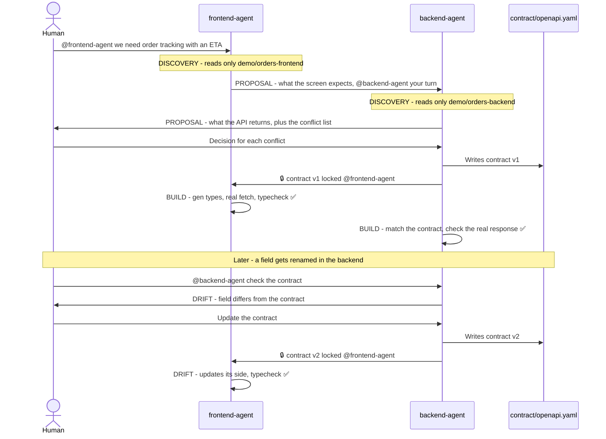

# Handshake 🤝

**Frontend and backend coding agents agree on the API contract before they build it, with a human making the final call, all inside one Switch room.**

Built for the **Flip the Switch Hackathon** (WeMakeDevs × DevTools Academy × Switch AI) · Track 01: Best Business Workflow · Team **Larpers**

> 🎥 **Demo video:** TODO (add link)
> 🧪 **Evidence of a real run:** the agents' actual changes from rehearsal 1 are on the
> [`rehearsal-1` branch (compare with main)](https://github.com/vaanyaagarwal27/handshake/compare/main...rehearsal-1).

---

## The problem

Frontend and backend teams lose days to one sentence: *"that's not the shape we agreed on."*
The frontend expects `minutesRemaining`, the backend sends a timestamp. The frontend sends `page` and `limit`, the backend returns everything. Nobody notices until integration, and by then both sides have built on the wrong assumption.

AI coding agents make this worse, not better: each one works fast on its own side, but neither knows what the other side actually does.

## How Handshake works

Each side's coding agent sits in **one shared Switch room** (a Discord channel). Each agent reads **only its own side's code**. They propose their half of the API, surface every mismatch as a conflict list, and wait. **A human decides**, the contract is locked as `contract/openapi.yaml`, and both agents build against it while a contract check stays green. If the backend later drifts, the check catches it and the agents fix it, again with a human approving the change.



Every agent message starts with a phase tag: `[DISCOVERY]` `[PROPOSAL]` `[ARBITRATION]` `[LOCKED]` `[BUILD]` `[DRIFT]`.

### The demo scenario

A food order tracking screen with an ETA. **This is a seeded demo:** the three mismatches are planted so the workflow is visible in 3 minutes. The two demo apps start out disagreeing:

| | Frontend (`demo/orders-frontend`) | Backend (`demo/orders-backend`) |
|---|---|---|
| ETA | expects `minutesRemaining` (number) | returns `eta` (ISO 8601 timestamp) |
| Pagination | sends `page` and `limit` | no pagination |
| Response shape | expects `{ orders, page, limit, total }` | returns a plain list |

The backend's ETAs are computed relative to the moment the server starts, so the screen always shows realistic "Arriving in N min" values.

<!-- SCREENSHOTS: remove this line and the closing one below once docs/images/ has the 5 PNGs
### Screenshots

| Conflict list | Locked contract | Both checks green |
|---|---|---|
|  |  |  |

| Before: mock data | After: real orders from the backend |
|---|---|
|  |  |
SCREENSHOTS end -->

## Why not just write the spec first, or use Pact?

Contract-first tools assume someone already wrote the contract. Handshake has each side's agent state what its code really does or needs, and turns the gaps into a list a human settles in one message. After that, the locked contract works like any contract-first setup: generated types, a check on every change, and drift caught early.

## Why Switch is essential

Handshake doesn't work as a single agent. It needs:

- **Two agents, each representing a different person.** backend-agent speaks for the backend dev, frontend-agent for the frontend dev. Both run on one Switch server.
- **Clear boundaries.** Each agent's instructions and the shared room rules limit it to its own demo folder, so it only knows its own side, like two real teams. (We run with Bypass permissions on because of a Switch Console bug, see [Known issue](#known-issue-zoderror-on-permission-prompts), so the boundary comes from the instructions, not from Switch.)
- **One shared room** where both agents and both humans talk, hand off with @mentions, and see the same conflict list.
- **A human in the loop.** Agents never settle a conflict. Only a human message in the room can (see `switch/room-rules.md`).

Switch provides all four: agents connected to a team chat, per-agent instructions and permissions, rooms with shared instructions, and humans and agents in the same conversation. Without Switch there's no shared room, and the negotiation can't happen.

## Contract checks

`scripts/check-contract.sh` runs both checks against `contract/openapi.yaml` and prints ✅ / ❌:

- **Backend:** calls the real `GET /orders?page=1&limit=5` and compares every field's name and type with the contract (`scripts/check_contract.py`). Missing fields, extra fields and wrong types all fail.
- **Frontend:** regenerates TypeScript types from the contract (`npm run gen:types`, using openapi-typescript), then runs `npm run typecheck`, which fails if the UI uses a field that isn't in the contract.

```
── backend: GET /orders vs contract ──
   ✅ response.orders[].eta
   ...
✅ backend matches the contract

── frontend: generated types + typecheck ──
✅ frontend matches the contract

✅ backend ✅ frontend: both sides match contract/openapi.yaml
```

After `scripts/sabotage.sh` renames `eta` to `estimated_arrival`, the backend half fails with `eta: missing` and `estimated_arrival: not in contract`.

## Repo structure

```
handshake/
├── README.md
├── switch/
│   ├── backend-agent.md       ← backend-agent's instructions
│   ├── frontend-agent.md      ← frontend-agent's instructions
│   └── room-rules.md          ← pasted into the room's Instructions in Switch
├── contract/
│   └── openapi.yaml           ← created by backend-agent at the lock (not in the repo at the start)
├── demo/
│   ├── orders-backend/        ← backend-agent's code (Python + FastAPI)
│   └── orders-frontend/       ← frontend-agent's code (React + Vite + TypeScript)
├── scripts/
│   ├── check-contract.sh      ← runs both contract checks
│   ├── check_contract.py      ← backend half: real response vs contract
│   ├── sabotage.sh            ← demo: renames a backend field to cause drift
│   └── reset-demo.sh          ← resets both apps to the seeded mismatch
└── docs/
    ├── project-brief.md
    ├── demo-script.md
    ├── recording-checklist.md
    └── submission.md
```

## Run it yourself

### Requirements

- macOS (that's what we tested on)
- [Docker Desktop](https://www.docker.com/products/docker-desktop/)
- Node.js 18+ and Python 3.9+
- Claude Code, signed in
- A Discord account and a server you can add a bot to

Switch docs: https://docs.switchagents.ai

### 1. Clone the repo

```bash
git clone https://github.com/vaanyaagarwal27/handshake.git
cd handshake
```

### 2. Run Switch locally

1. Install and open **Docker Desktop**.
2. Install **Switch Console** and start a **local Switch server**, following the getting-started guide in the [Switch docs](https://docs.switchagents.ai).
3. Sign Claude Code in to your Switch server from Switch Console. Only the person who runs the local server can sign in to it, so both agents run on that machine. Other people take part through Discord.

### 3. Connect Discord

1. In the [Discord Developer Portal](https://discord.com/developers/applications), create an application and a bot.
2. Under **Bot → Privileged Gateway Intents**, turn on **Message Content Intent** and **Server Members Intent**.
3. Invite the bot to your server.
4. Connect the bot to your Switch server in Switch Console (see the Switch docs for Discord).

### 4. Create the two agents

In Switch Console, create both agents with **Claude Code**:

| Agent | Directory | Instructions |
|---|---|---|
| `backend-agent` | the **repo root** (e.g. `~/handshake`) | contents of `switch/backend-agent.md` |
| `frontend-agent` | the **repo root** (e.g. `~/handshake`) | contents of `switch/frontend-agent.md` |

Both agents use the repo root so they can read `contract/openapi.yaml`. Their instructions and the room rules limit each one to its own `demo/` folder.

Settings we used for both agents:
- **Auto mode:** on
- **Bypass permissions:** on (see [Known issue](#known-issue-zoderror-on-permission-prompts))
- **Who can talk to your agent:** Anyone (fine on a private server). This lets each agent answer the other agent's @mentions.
- **Persistent memory:** off

### 5. Start both apps

Backend (http://localhost:8000):

```bash
cd demo/orders-backend
python3 -m venv .venv
source .venv/bin/activate
pip install -r requirements.txt
uvicorn main:app --reload
```

Frontend (http://localhost:5173), in a second terminal:

```bash
cd demo/orders-frontend
npm install
npm run dev
```

### 6. Set up the room

1. Create a new Discord channel (e.g. `#handshake`) and post any message in it, e.g. `hello`. This creates the Switch room.
2. Invite both agents, picking each one from Discord's autocomplete:
   ```
   !invite-agent @backend-agent
   !invite-agent @frontend-agent
   ```
3. In Switch Console → **Your Rooms** → your room → **Configuration → Instructions**, paste `switch/room-rules.md` and save.

### 7. Start the negotiation

Post this in the channel:

```
@frontend-agent we need order tracking with an ETA on the orders screen.
```

frontend-agent proposes and starts a thread. backend-agent answers in that thread with its proposal and the conflict list. **You decide each conflict, in the thread**, for example:

```
ETA: keep eta as an ISO timestamp; frontend computes minutes remaining.
Pagination: add page/limit query params.
Response shape: wrap it as { orders, page, limit, total }.
```

backend-agent locks the contract, both agents build, and you check the result:

```bash
./scripts/check-contract.sh
```

**Optional, to see drift:** run `./scripts/sabotage.sh`, then post `@backend-agent check the contract`, and after it reports the drift, `@backend-agent update the contract`.

## One room per run

A Switch room remembers its whole history, so every fresh demo needs a **fresh Discord channel**. A reused channel makes the agents mix up runs. To skip the setup each time, capture a configured room with **Capture as template** in Switch Console and reuse it.

## Resetting between runs

```bash
./scripts/reset-demo.sh
```

This restores `demo/` to the `demo-start` git tag (the seeded mismatch), removes anything the agents created in `demo/` and `contract/`, and deletes `contract/openapi.yaml`. Then restart the backend (fresh ETAs) and use a new channel.

## Known issue: ZodError on permission prompts

In **Switch Console v0.40.1**, when an agent action needs approval (Write/Bash), the permission check fails with a ZodError instead of showing a prompt, and the agent gets stuck. **Workaround:** turn on **Bypass permissions** for both agents. Each agent's folder limits then come from its instructions and the room rules.

## Team

**Team Larpers**
- **Vaanya Agarwal**: backend, Switch setup, backend-agent
- **Hamsini V**: frontend, frontend-agent, demo video

Built with **Claude Code**, both for building this repo and as the two agents inside Switch.