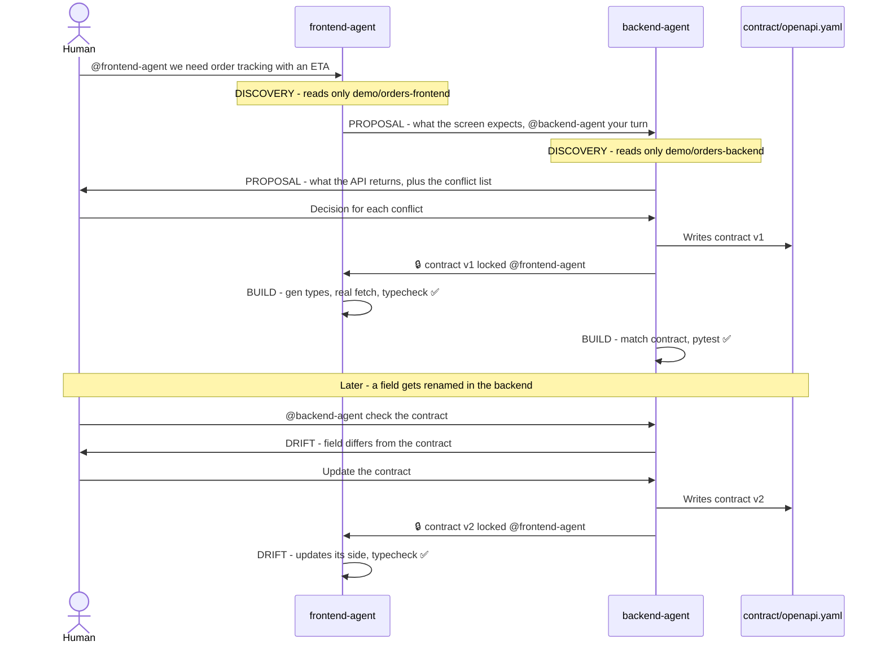

# Handshake 🤝

**Frontend and backend coding agents agree on the API contract before they build it, with a human making the final call, all inside one Switch room.**

Built for the **Flip the Switch Hackathon** (WeMakeDevs × DevTools Academy × Switch AI) · Track 01: Best Business Workflow · Team **Larpers**

> 🎥 **Demo video:** TODO (add link)
> 📸 **Screenshots:** TODO (conflict list, locked contract, green checks)

---

## The problem

Frontend and backend teams lose days to one sentence: *"that's not the shape we agreed on."*
The frontend expects `minutesRemaining`, the backend sends a timestamp. The frontend sends `page` and `limit`, the backend returns everything. Nobody notices until integration, and by then both sides have built on the wrong assumption.

AI coding agents make this worse, not better: each one works fast on its own side, but neither knows what the other side actually does.

## How Handshake works

Each side's coding agent sits in **one shared Switch room** (a Discord channel). Each agent reads **only its own side's code**. They propose their half of the API, surface every mismatch as a conflict list, and wait. **A human decides**, the contract is locked as `contract/openapi.yaml`, and both agents build against it while a contract check stays green. If the backend later drifts, the check catches it and the agents fix it, again with a human approving the change.



Every agent message starts with a phase tag: `[DISCOVERY]` `[PROPOSAL]` `[ARBITRATION]` `[LOCKED]` `[BUILD]` `[DRIFT]`.

### The demo scenario

A food order tracking screen with an ETA. The two demo apps are seeded so they **already disagree**:

| | Frontend (`demo/orders-frontend`) | Backend (`demo/orders-backend`) |
|---|---|---|
| ETA | expects `minutesRemaining` (number) | returns `eta` (ISO 8601 timestamp) |
| Pagination | sends `page` and `limit` | no pagination |
| Response shape | expects `{ orders, page, limit, total }` | returns a plain list |

## Why Switch is essential

Handshake doesn't work as a single agent. It needs:

- **Two agents, each owned by a different person.** backend-agent belongs to the backend dev, frontend-agent to the frontend dev. Each one represents its owner's side.
- **Hard boundaries.** Each agent's working directory is its own demo folder, so it can only know its own side, exactly like two real teams.
- **One shared room** where both agents and both humans talk, hand off with @mentions, and see the same conflict list.
- **A human in the loop.** Agents never settle a conflict. Only a human message in the room can (see `switch/room-rules.md`).

Switch provides all four: agents connected to a team chat, per-agent owners and working directories, rooms with shared instructions, and humans and agents in the same conversation. Without Switch there's no shared room, and the negotiation can't happen.

## Contract checks

- **Backend:** `pytest` compares FastAPI's real response with `contract/openapi.yaml`.
- **Frontend:** TypeScript types are generated from the contract (`npm run gen:types`, using openapi-typescript), and `npm run typecheck` fails if the UI uses a field that isn't in the contract.
- `scripts/check-contract.sh` runs both and prints ✅ / ❌.

## Repo structure

```
handshake/
├── README.md
├── switch/
│   ├── backend-agent.md       ← backend-agent's instructions
│   ├── frontend-agent.md      ← frontend-agent's instructions
│   └── room-rules.md          ← pasted into the room's Instructions in Switch
├── contract/
│   └── openapi.yaml           ← created by backend-agent at the lock (not in the repo at the start)
├── demo/
│   ├── orders-backend/        ← backend-agent's working directory (Python + FastAPI)
│   └── orders-frontend/       ← frontend-agent's working directory (React + Vite + TypeScript)
├── scripts/
│   ├── check-contract.sh      ← runs both contract checks
│   ├── sabotage.sh            ← demo: renames a backend field to cause drift
│   └── reset-demo.sh          ← resets both apps to the seeded mismatch
└── docs/
    ├── project-brief.md
    ├── demo-script.md
    └── submission.md
```

TODO: check this matches the final repo (e.g. whether `switch/handshake.template.yaml` exists).

## Run it yourself

### Requirements

- macOS (TODO: tested on other systems?)
- [Docker Desktop](https://www.docker.com/products/docker-desktop/)
- Node.js 18+ and Python 3 (TODO: minimum Python version)
- Claude Code, signed in
- A Discord account and a server you can add a bot to

Switch docs: https://docs.switchagents.ai

### 1. Clone the repo

```bash
git clone https://github.com/vaanyaagarwal27/handshake.git
cd handshake
```

### 2. Run Switch locally

1. Install and open **Docker Desktop**.
2. Install **Switch Console** (TODO: link from the Switch docs).
3. In Switch Console, start a **local Switch server** on your machine.
4. Sign Claude Code in to Switch (TODO: exact steps).

### 3. Connect Discord

1. In the [Discord Developer Portal](https://discord.com/developers/applications), create an application and a bot.
2. Under **Bot → Privileged Gateway Intents**, turn on **Message Content Intent** and **Server Members Intent**.
3. Invite the bot to your server and create a channel, e.g. `#handshake`.
4. Connect the bot in Switch Console (TODO: exact steps).

### 4. Create the two agents

In Switch Console, create both agents with **Claude Code** in **Auto mode**:

| Agent | Directory | Instructions |
|---|---|---|
| `backend-agent` | `<repo>/demo/orders-backend` | contents of `switch/backend-agent.md` |
| `frontend-agent` | `<repo>/demo/orders-frontend` | contents of `switch/frontend-agent.md` |

TODO: owner settings, and the permission that lets each agent reply to the other agent's @mentions.

### 5. Set up the room

1. Create a room for your channel (TODO: exact steps).
2. Paste `switch/room-rules.md` into the room's **Instructions** box.
3. In the Discord channel, invite both agents:
   ```
   !invite-agent backend-agent
   !invite-agent frontend-agent
   ```
   TODO: confirm exact command syntax.

### 6. Start both apps

Backend (http://localhost:8000):

```bash
cd demo/orders-backend
python3 -m venv .venv
source .venv/bin/activate
pip install -r requirements.txt
uvicorn main:app --port 8000
```

Frontend (http://localhost:5173), in a second terminal:

```bash
cd demo/orders-frontend
npm install
npm run dev
```

TODO: confirm the backend commands match `demo/orders-backend`.

### 7. Start the negotiation

Post this in the channel:

```
@frontend-agent we need order tracking with an ETA on the orders screen.
```

Then watch the room: frontend-agent proposes, backend-agent proposes and posts the conflict list, **you decide each conflict**, backend-agent locks the contract, and both agents build. Check the result:

```bash
./scripts/check-contract.sh
```

**Optional, to see drift:** run `./scripts/sabotage.sh`, then post `@backend-agent check the contract`.

## Resetting between runs

```bash
./scripts/reset-demo.sh
```

This resets both demo apps to the seeded mismatch (TODO: describe exactly what it resets, e.g. the `demo-start` git tag). Use a **fresh Discord channel** for every run, so the agents start without memory of the last one.

## Team

**Team Larpers**
- **Vaanya Agarwal**: backend, Switch setup, backend-agent
- **Hamsini V**: frontend, frontend-agent, demo video

Built with **Claude Code**, both for building this repo and as the two agents inside Switch.

TODO: license# handshake
